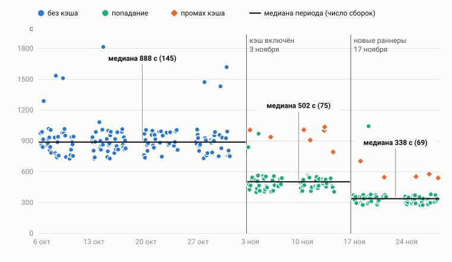

# Кэш зависимостей в CI: что изменилось после включения

Допустим, ваша команда решает, включать ли кэш зависимостей. Первый вопрос — сколько времени сборки он сэкономит. Мы это посчитали у себя, и простое сравнение «до» и «после» тут не сработало.

Наш монорепозиторий бэкенда — около 40 сервисов на Gradle и Kotlin. 3 ноября 2025 года мы включили кэш зависимостей. 17 ноября инфраструктурная команда заменила раннеры old-4cpu на новые 8-ядерные new-8cpu. Сборки ускорились после обоих изменений, и в выгрузке из CI за 8 недель общее ускорение выглядит как заслуга кэша. Мы сами записали всё на кэш.

Поэтому мы отделяем кэш от замены раннеров и считаем изменения после включения кэша только по сборкам на одних и тех же раннерах old-4cpu. Промахи кэша показываем как есть: это сборки, которые не нашли кэш. Их оказалось больше, чем я ожидала.

## Как устроен кэш

Все сборки в этой статье — полный пайплайн: стадия зависимостей, компиляция и юнит-тесты. Других сборок в выгрузке из CI нет, так что и все числа дальше — про полный пайплайн.

Кэш хранит скачанные зависимости и артефакты сборки зависимостей. Входят ли в него результаты компиляции наших сервисов, я не проверяла. Хранилище S3-совместимое и стоит в том же датацентре, что и раннеры.

Ключ кэша — хеш lock-файлов, в которых зафиксированы версии зависимостей. Сборка ищет кэш по своему ключу. Нашла — это попадание. Не нашла — промах кэша.

Промах бывает, когда меняется ключ, то есть хеш lock-файлов: например, когда кто-то обновил зависимости. Бывают ли промахи и по другим причинам, мы не проверяли. Проверить это по выгрузке нельзя: в ней у каждой сборки с кэшем есть только отметка «попадание» или «промах», а почему промахнулась конкретная сборка, не видно.

## После включения кэша сборка на тех же раннерах шла примерно в 1,8 раза быстрее

Чтобы не смешать кэш с заменой раннеров, мы сравниваем только сборки на старых раннерах old-4cpu. Без кэша — четыре недели, 6–31 октября 2025 года, 145 сборок. С кэшем — две недели, 3–14 ноября, 75 сборок. Не менялось ли что-то ещё в те дни, мы не проверяли. На 14 ноября сравнение кончается: 15–16 ноября — выходные, сборок нет, а с 17 ноября сборки идут уже на новых раннерах.

Медиана полного пайплайна упала с 888 с (145 сборок) до 502 с (75 сборок), то есть с 14,8 до 8,4 минуты. Это −43%, примерно в 1,8 раза. На рисунке в разделе о раннерах видно, что уровень сборок падает после 3 ноября, но это не доказывает, что причина только в кэше: другие изменения около 3 ноября мы не исключали.

Медиана здесь и дальше посчитана по всем сборкам полного пайплайна, включая упавшие и флаки: разработчик ждёт любую сборку, а не только зелёную. По одним успешным сборкам (130 без кэша и 66 с кэшем) вышло −45%. Флаки-сборок было 8 из 145 в октябре, 2 из 75 в первые две недели ноября и 1 из 69 в последние две, уже на новых раннерах.

Сборки с промахом кэша тоже входят в медиану 502 с: их 7 из 75. Мы их не выкидываем: иначе выйдет красивее, чем есть.

## Что добавили новые раннеры

На новых раннерах new-8cpu сборки тоже идут с кэшем. Медиана полного пайплайна за 17–28 ноября — 338 с (69 сборок), это 5,6 минуты. На старых раннерах с кэшем было 502 с (75 сборок), это 8,4 минуты.

Сборки с кэшем и без него мы сравнили только на старых раннерах old-4cpu. Мы включили кэш 3 ноября, а инфраструктурная команда заменила раннеры 17 ноября, когда кэш уже работал во всех сборках. Сколько дали бы новые раннеры без кэша, мы не мерили. Поэтому наши 1,8 раза нельзя переносить на быстрые раннеры: что там будет, мы не знаем.

За 8 недель медиана упала с 888 с (145 сборок) до 338 с — это кэш и раннеры вместе. После включения кэша, ещё на старых раннерах, медиана упала с 888 до 502 с. После замены раннеров, уже с кэшем, она упала с 502 до 338 с.

*Все 289 сборок полного пайплайна из выгрузки. Точка — одна сборка, по вертикали — её длительность в секундах. Уровень сборок падает дважды: после включения кэша 3 ноября и после замены раннеров 17 ноября (вертикальные линии). У каждого периода подписана медиана и число сборок, по которым она посчитана.*

На рисунке сборки с промахом кэша лежат выше основной массы сборок своего периода. Три сборки с попаданием тоже лежат выше основной массы, две 3–4 ноября и одна 19 ноября: это флаки-сборки.

## Промахи: чаще, чем я ожидала

С 3 по 28 ноября сборок с кэшем было 144, и 12 из них не нашли кэш — это около 8%. Я ожидала около 3%.

На старых раннерах old-4cpu промахов было 7 из 75. Медиана сборок с попаданием — 484,5 с (68 сборок), с промахом — 1001 с (7 сборок). Вместе с промахами медиана всех сборок с кэшем — 502 с (75 сборок): разницу с 484,5 с дают промахи. Без кэша, в октябре, медиана была 888 с (145 сборок). Медиана сборок с промахом оказалась выше, чем без кэша: 1001 с против 888 с. Почему промах дольше сборки без кэша, я не знаю. По семи сборкам нельзя утверждать, что промах всегда дольше сборки без кэша.

Остальные промахи — на новых раннерах new-8cpu: 5 из 69. Таких сборок ещё меньше, поэтому сравнивать я не стала.

Сколько обновлений зависимостей было в ноябре, из числа промахов я не вывожу.

## Как прикинуть у себя

Прикинуть выигрыш у себя можно по двум величинам. Первая — какую долю вашего пайплайна занимает стадия зависимостей. Наш кэш хранит скачанные зависимости и артефакты сборки зависимостей. Выигрыш не больше времени тех стадий, которые кэш покрывает. Долю стадии зависимостей в пайплайне до кэша мы не замеряли, разбивки по стадиям нет.

Вторая — как часто у вас меняются lock-файлы. Ключ кэша у нас считается по ним, и после каждого изменения он новый. В нашей выгрузке из 144 сборок с кэшем промахнулись 12, около 8%. Как часто менялись наши lock-файлы, мы не замеряли.

Мы мерили в одном монорепозитории: на старых раннерах old-4cpu медиана полного пайплайна упала с 888 с (145 сборок) до 502 с (75 сборок), на 43%. Хранилище кэша S3-совместимое и стоит в том же датацентре, что и раннеры. Как кэш работает с хранилищем дальше от раннеров, мы не проверяли. В других условиях выигрыш может быть другим. Стоимость хранилища и раннеров мы не оценивали.
