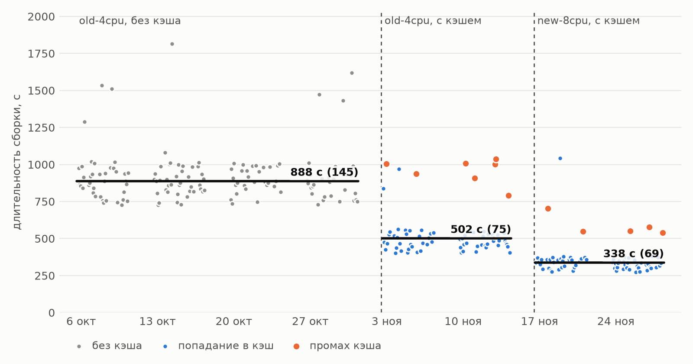

# Кэш зависимостей в CI: что он нам дал

У нас монорепозиторий бэкенда: около 40 сервисов на Gradle и Kotlin. 3 ноября 2025 года мы включили в CI кэш зависимостей, а 17 ноября инфраструктурная команда заменила старые раннеры old-4cpu на новые new-8cpu. Я взяла выгрузку из CI за восемь недель, в ней 289 сборок. Полный пайплайн у нас — это зависимости, компиляция и юнит-тесты.

После включения кэша медиана полного пайплайна на тех же старых раннерах упала с 888 с (145 сборок) до 502 с (75 сборок, из них часть с промахом кэша). Это −43%, примерно в 1,8 раза, или с 14,8 до 8,4 минуты, но кроме кэша около 3 ноября могло поменяться что-то, о чём я не знаю.

Промахов кэша оказалось больше, чем я ждала, а на старых раннерах семь сборок с промахом шли не быстрее, чем без кэша.

База без кэша — 6–31 октября 2025 года, замер с кэшем — 3–14 ноября 2025 года: четыре недели против двух. Держался ли эффект обе недели, я не знаю: по неделям не смотрела. 15–16 ноября — выходные, сборок нет, а с 17 ноября работают уже новые раннеры, на них 69 сборок.

В выгрузке только сборки полного пайплайна. Медиану я считаю по всем сборкам, включая упавшие и флаки: разработчик ждёт любую сборку, а не только зелёную. У каждой медианы в скобках стоит число сборок, по которым она посчитана. Флаки-сборок было 8 из 145 за 6–31 октября, 2 из 75 за первые две недели с кэшем и 1 из 69 на новых раннерах. Убрать их из медианы — значит подогнать цифру под красивый вывод. По одним успешным сборкам, без упавших и флаки (130 без кэша и 66 с кэшем), выходит −45%.

## Как устроен кэш

В кэше лежат скачанные зависимости и артефакты сборки зависимостей. Компиляцию наших сервисов кэш не покрывает. Всё это — в S3-совместимом хранилище в том же датацентре, что и раннеры.

Ключ кэша — хеш lock-файлов. Сборка ищет в хранилище запись по этому ключу: нашла — попадание, не нашла — промах, и тогда зависимости скачиваются и собираются так же, как без кэша. Промах бывает, например, когда кто-то обновил зависимости: вместе с lock-файлами меняется и ключ.

Раннеры к этой схеме не относятся, но 17 ноября инфраструктурная команда поменяла и их. С этой даты на время сборки влияют обе перемены.

## Не всё ускорение — от кэша

Что раннеры поменяли 17 ноября, я знала. Но в голове всё равно было «ускорение = кэш». У нас так и говорят: кэш ускорил втрое.

В выгрузке на самом деле три периода. Первый — 6–31 октября: старые раннеры old-4cpu без кэша, медиана 888 с (145 сборок). Второй — 3–14 ноября: те же раннеры, но уже с кэшем, 502 с (75 сборок). Третий — 17–28 ноября: новые раннеры new-8cpu, тоже с кэшем, 338 с (69 сборок).

*Каждая точка — сборка полного пайплайна. Пунктир — 3 ноября, когда мы включили кэш, и 17 ноября, когда инфраструктурная команда поставила новые раннеры. Чёрный отрезок — медиана периода по всем сборкам, включая упавшие и флаки, в скобках — число сборок. Оранжевым отмечены промахи кэша.*

Выигрыш от кэша мы измерили только на old-4cpu: в первых двух периодах раннеры одни и те же. Отсюда −43% из начала статьи, с теми же оговорками: замер с кэшем вдвое короче базы, а кроме кэша около 3 ноября могло поменяться что-то, о чём я не знаю.

Между вторым и третьим периодом кэш уже работал, а поменялись раннеры, и медиана упала ещё на 33%. Эти 33% совпали со сменой раннеров при уже работающем кэше. Что ещё могло поменяться около 17 ноября, я так же не знаю, как и про 3 ноября. Про new-8cpu мне известно только число ядер: раннеры меняла инфраструктурная команда, не моя. Сборок на new-8cpu без кэша у нас нет, поэтому мы не мерили, сколько раннеры дали бы без кэша и сколько кэш даёт на new-8cpu.

Если сравнить октябрь сразу с концом ноября, выйдет −62%: 888 с (145 сборок) против 338 с (69 сборок). Проценты по шагам не складываются: −33% считаются от 502 с, а не от 888 с. Вот это общее ускорение и есть то самое «втрое». Втрое не выходит даже так: получается в 2,6 раза. И кэш в этом ускорении — только одна из двух перемен, о которых мы знаем.

На рисунке в обоих периодах с кэшем часть сборок выбивается далеко вверх от своей медианы. Оранжевые среди них — промахи кэша, остальные — флаки.

## На старых раннерах сборка с промахом не быстрее, чем без кэша

С 3 по 28 ноября, на старых и новых раннерах вместе, у нас 144 сборки с кэшем. Из них 12 — промахи кэша. Я ждала около трёх процентов, вышло около восьми. Промахи есть в обоих периодах с кэшем, всплеска сразу после 3 или 17 ноября нет. По выгрузке не понять, бывают ли промахи не из-за обновления зависимостей: там у каждой сборки только отметка, попала она в кэш или нет.

На старых раннерах old-4cpu медиана сборок с промахом — 1001 с (7 сборок). Без кэша на тех же раннерах медиана была 888 с (145 сборок), а у сборок с попаданием — 484,5 с (68 сборок). Получается, что сборка с промахом на old-4cpu идёт не быстрее, чем вовсе без кэша. На рисунке выше оранжевые точки второго периода так и лежат на уровне октябрьских сборок. Вывод держится только на этих семи сборках, и разница с октябрём может быть случайной. Почему медиана у них даже выше, чем без кэша, я не мерила, в выгрузке этого нет. Гипотез у меня две: если промах случился из-за обновления lock-файла, сборке и так приходится больше скачивать и компилировать; а после промаха она, возможно, ещё и сохраняет новый кэш в хранилище, и это время входит в сборку.

На new-8cpu попадание 335 с (64 сборки), промах 552 с (5 сборок): разница 217 с. На old-4cpu разница 516,5 с. Промахов на новых раннерах пять, так что 217 с — оценка грубая.

Общую медиану наши промахи почти не сдвигают: их мало, а медиана к редким долгим сборкам мало чувствительна. По всем 75 сборкам с кэшем на old-4cpu она 502 с, по одним попаданиям 484,5 с. Но у тех семи, кому достался промах, сборка шла как без кэша.

## Как прикинуть у себя

Всё это мы измерили на одном монорепозитории, а кэш у нас лежит в S3-совместимом хранилище в том же датацентре, что и раннеры. В других условиях выигрыш может отличаться. Для вашего пайплайна важны две величины. Доля стадии зависимостей в полном пайплайне показывает, сколько вообще можно выиграть. Свою долю стадии зависимостей до кэша мы не замеряли: разбивки по стадиям у нас нет. Частота смены lock-файлов показывает, как часто ждать промахов из-за обновления зависимостей. Стоимость хранилища и раннеров мы не оценивали.

У нас кэш и новые раннеры появились в один месяц, с разницей в две недели. С кэшем медиана на старых раннерах стала меньше примерно в 1,8 раза. Без кэша на новых раннерах мы не мерили, поэтому вклад кэша в общее ускорение в 2,6 раза отдельно не назвать.

Нашу медиану без кэша мы посчитали за четыре недели, по 145 сборкам. Прежде чем включать кэш, зафиксируйте медиану длительности полного пайплайна на своих раннерах и не меняйте ничего другого в тот же месяц. Иначе вы не отличите кэш от остального.
