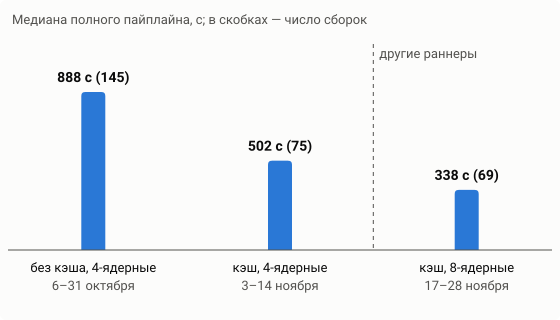

# Кэш зависимостей в CI: что он нам дал

В ноябре 2025 года полный пайплайн нашего монорепозитория бэкенда стал быстрее. В монорепозитории около 40 сервисов на Gradle и Kotlin. 3 ноября мы включили в нём кэш зависимостей.

Через две недели, 17 ноября, инфраструктурная команда заменила старые 4-ядерные раннеры на 8-ядерные. Я это знала, но в голове было «ускорение = кэш». А известных изменений за эти недели было два. Если вы прикидываете кэш у себя, вам нужен выигрыш от одного кэша, без смены раннеров.

Я считала по выгрузке из CI за 8 недель, с 6 октября по 28 ноября 2025 года. В ней 289 сборок полного пайплайна. Выгрузку я делала сама, скриптом. Выигрыш от кэша — только на 4-ядерных раннерах: октябрь без кэша против первых двух недель ноября с кэшем.

## Как устроен кэш

Полный пайплайн у нас проходит стадии по порядку: зависимости, компиляция, юнит-тесты. Кэш ускоряет первую. В нём лежат скачанные зависимости и артефакты сборки зависимостей. Хранилище S3-совместимое и стоит в том же датацентре, что и раннеры.

Ключ кэша — хеш lock-файлов. Если сборка находит кэш по своему ключу, это попадание, и готовые зависимости она берёт из хранилища. Не нашла — промах, и тогда стадия зависимостей проходит целиком, без кэша. Так бывает, когда кто-то обновил зависимости: меняются lock-файлы, а с ними и ключ. Причину промаха выгрузка не показывает: про кэш там записано только, попала в него сборка или нет.

## Что дал кэш и что дали раннеры

Чтобы увидеть выигрыш от одного кэша, я сравнила сборки на одних и тех же 4-ядерных раннерах. Без кэша это 145 сборок с 6 по 31 октября 2025 года. С кэшем — 75 сборок с 3 по 14 ноября. 15–16 ноября выходные, сборок нет, а дальше уже новые раннеры. Периоды разной длины: четыре недели без кэша, две с кэшем. Других изменений около 3 ноября мы не исключали.

Медиана полного пайплайна упала с 888 с (145 сборок) до 502 с (75 сборок). Это −43%, примерно в 1,8 раза. По медиане сборку ждали 14,8 минуты, а стали ждать 8,4.

Медиану я считала по всем сборкам: с упавшими и флаки. Разработчик ждёт любую сборку, а не только зелёную. Вычищать флаки из медианы значит подгонять цифру под красивый вывод. Флаки-сборок было 8 до кэша, 2 с кэшем на 4-ядерных раннерах и 1 на 8-ядерных. По одним успешным сборкам выходит −45%, почти то же.

С 17 ноября сборки шли на 8-ядерных раннерах. Медиана опустилась до 338 с (69 сборок), ещё на 33% против 4-ядерных с кэшем. Это вклад раннеров при включённом кэше. Других изменений в эти дни мы не исключали. Что дали бы 8 ядер без кэша, я не знаю: так никто не собирал.

## Промахи

Всего с кэшем с 3 по 28 ноября прошло 144 сборки. Промахов среди них было 12, около 8%, то есть каждая двенадцатая сборка. Я ожидала около 3%, но это была догадка, не расчёт.

На 4-ядерных раннерах попадания шли с медианой 484,5 с (68 сборок), промахи — 1001 с (7 сборок). До кэша на тех же раннерах медиана была 888 с (145 сборок), так что эти семь сборок с промахом шли не быстрее, чем без кэша.

На 8-ядерных разрыв меньше: попадания шли с медианой 335 с (64 сборки), промахи — 552 с (5 сборок). Но промахов там всего пять.

## Как прикинуть у себя

Кэш сократил у нас медиану примерно в 1,8 раза, но только на 4-ядерных раннерах, в одном монорепозитории и со своим S3-совместимым хранилищем в том же датацентре.

Руководству «примерно в 2,6 раза» не обещайте. Столько вышло с октября по конец ноября, но это кэш вместе с 8-ядерными раннерами. Стоимость хранилища и раннеров мы не оценивали.

Решают две цифры: какую часть пайплайна у вас занимает стадия зависимостей и как часто меняются lock-файлы. Выиграть можно не больше, чем стадия занимает сейчас, а сборка с промахом идёт как без кэша. Сколько занимает стадия зависимостей у нас, мы не замеряли.
